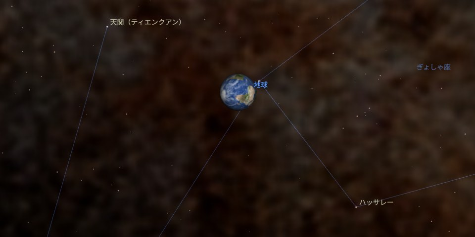
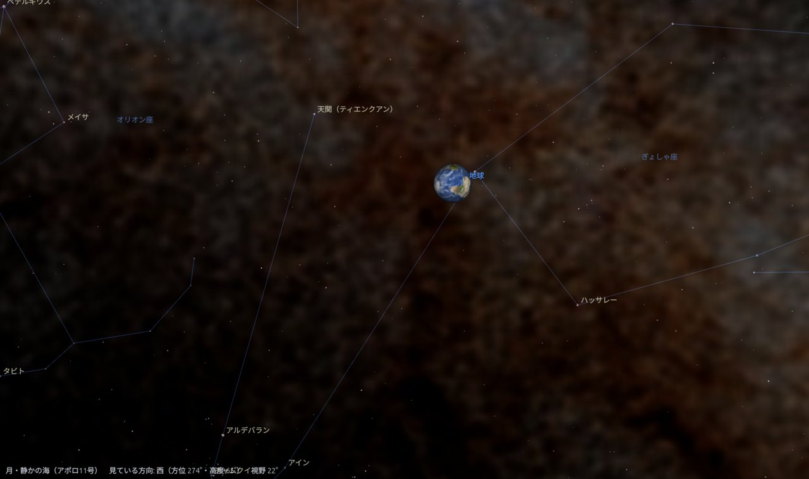
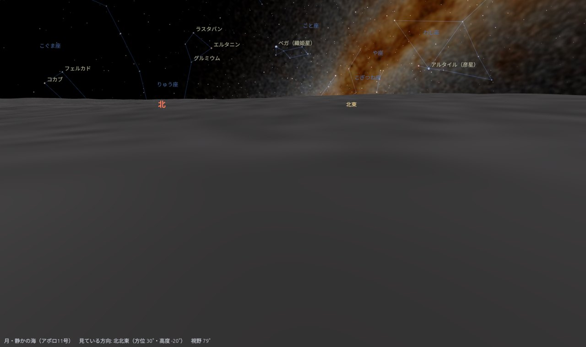
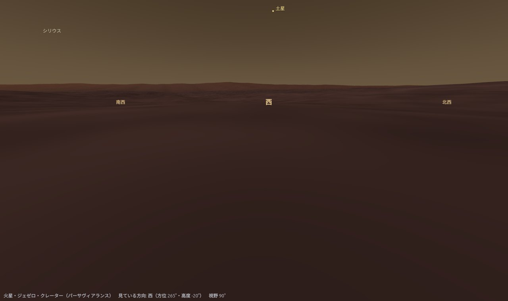
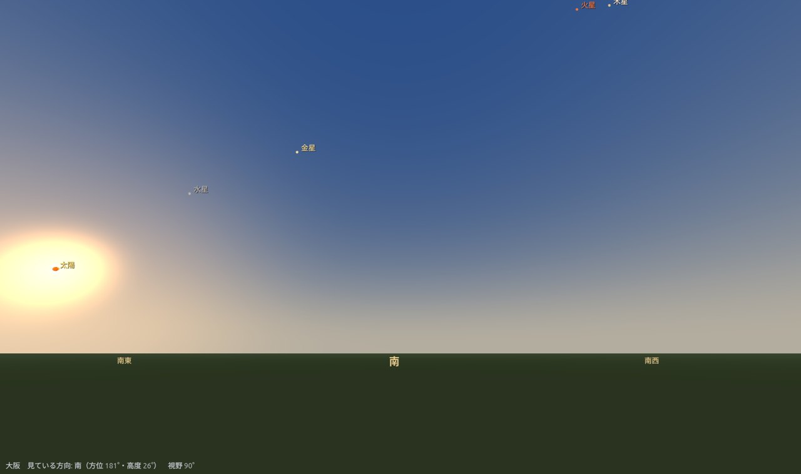
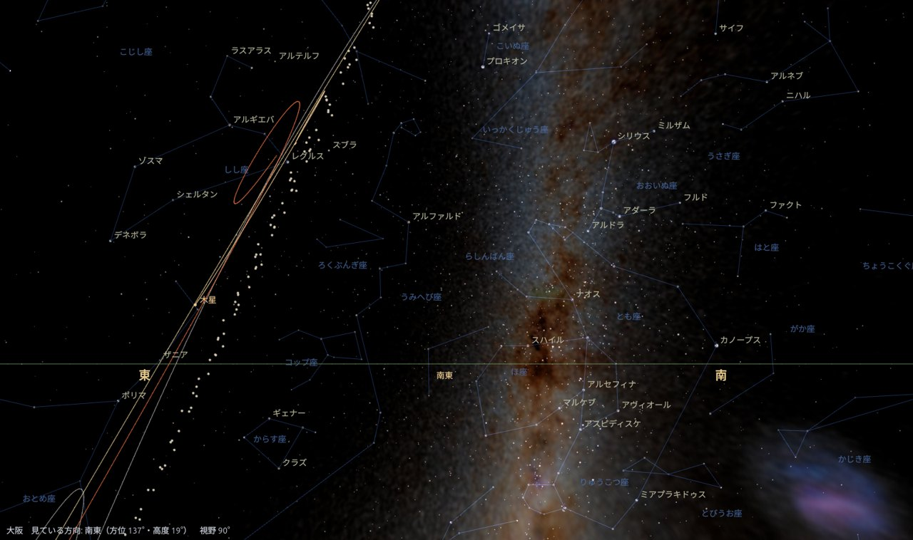
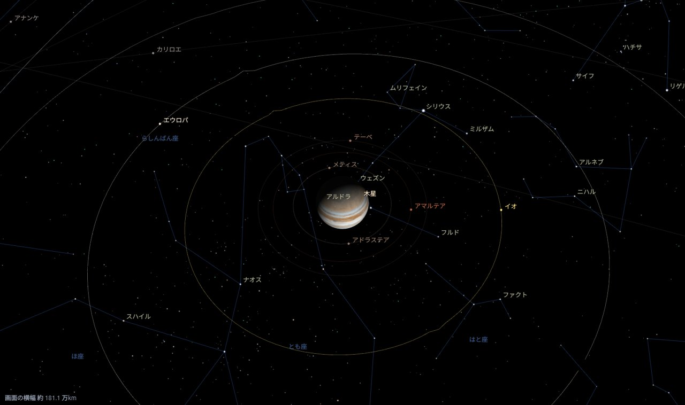
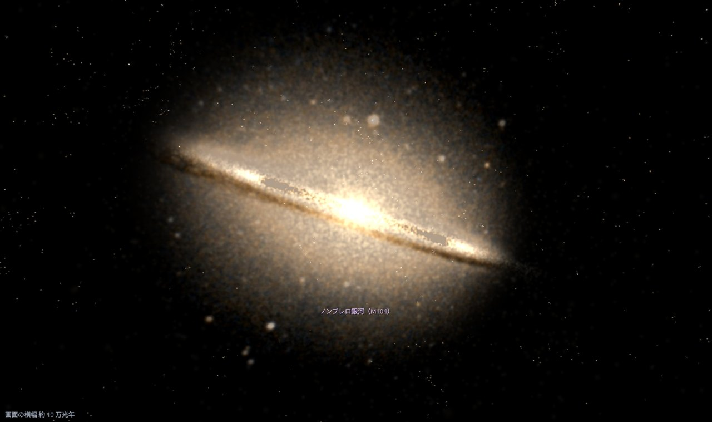
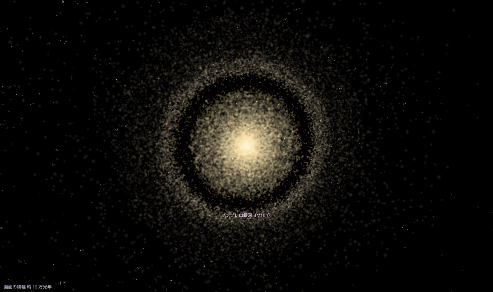

# そらみ窓（Soramado）

<p align="center"></p>

**Ubuntu で動く、Mitaka のような宇宙シミュレーターです。**
太陽系から宇宙の大規模構造まで 3D で自由に飛び回り、地上に降りればプラネタリウムに。
月や火星に降り立って、NASA の本物の地形の上から空を見上げることもできます。

[**⬇ 最新版をダウンロード（DEB）**](https://github.com/kenjiiida-commits/Soramado/releases/latest)　｜　日本語・English　｜　MIT ライセンス　｜　作者: 飯田顕治

> このソフトは国立天文台の Mitaka とは関係のない、独自に作ったソフトです。

**English:** Soramado is a free 3D space simulator for Ubuntu, in the spirit of Mitaka.
Fly from the Earth to the edge of the observable universe, watch the sky from anywhere on Earth with a
realistic atmosphere, look through virtual telescopes, and land on the Moon and Mars with real NASA terrain.
The interface is available in English: **View → 言語 / Language → English**, then restart.
(Object descriptions, tour captions and the manual are mostly in Japanese.)
[See the English summary below.](#english)

## スクリーンショット

| | |
|:---:|:---:|
| <br>月面（静かの海）から見た地球 | <br>月の昼。空気がないので昼でも星と天の川 |
| <br>火星・ジェゼロ・クレーター（NASA の地形） | <br>大阪から見た空（大気の色・夕日） |
| <br>火星の逆行（大気なし・恒星日のコマ送り） | <br>土星と衛星の軌道 |
| <br>ソンブレロ銀河（本物の写真） | <br>銀河を真上から（粒の模式図） |

## インストール（かんたん）

1. [Releases の最新版](https://github.com/kenjiiida-commits/Soramado/releases/latest) から `soramado_x.x.x_all.deb` をダウンロード
2. 端末で次を実行（ファイル名は、ダウンロードしたものに合わせてください）

```bash
cd ~/ダウンロード
sudo apt install ./soramado_*_all.deb
```

3. アプリ一覧の「そらみ窓」から起動します。惑星の画像や星雲の写真などは、はじめて使うときにダウンロードするか聞かれます（どれも任意）。

## できること

**宇宙を旅する**
- 地球のそばから「観測できる宇宙の果て」（約444億光年）まで、ホイールでなめらかに引いていける
- 太陽系：惑星・月が実際の日付どおりの位置に。惑星の画像（ダウンロード）、土星・天王星・海王星の環
- 衛星：おもな衛星に加えて、木星・土星・天王星・海王星の小さな衛星や不規則衛星（全部で約80個）
- 準惑星・小惑星・彗星（彗星の尾つき）
- 探査機 20機の航路（NASA JPL Horizons の位置）：ボイジャー1・2号、パイオニア10・11号、ガリレオ、カッシーニ、ニュー・ホライズンズ、ジュノー、パーカー・ソーラー・プローブ、メッセンジャー、ベピコロンボ、ロゼッタ、ドーン、オシリス・レックス、エウロパ・クリッパー、JUICE、ルーシー、サイキ、はやぶさ、はやぶさ2
- 約11万個の恒星（HYG）と星座線。近くの恒星のあいだを飛ぶと、星座の形がくずれていく
- 星雲・星団 約90個、天の川銀河と近くの銀河（模式図。写真もダウンロードできる）、実在の銀河 約1万個、宇宙マイクロ波背景放射（模式図）

**ダウンロードして増やせるもの**（すべて任意）
- 小惑星・彗星 約90万個（NASA JPL）：なかまごとに色分け、ダブルクリックで名前と軌道
- 系外惑星 約6千個（NASA Exoplanet Archive）：惑星系へ飛んで、惑星の一覧とハビタブルゾーン
- 人工衛星（CelesTrak）：ISS などが地球のまわりを回る。観測地で見える時刻の一覧
- クエーサー 約75万個（SDSS）
- 星雲・銀河の写真 約95個（DSS2 color、ESA ESASky から）：地球の側から見ると本物の写真、横から見ると模式図
- 天の川の全天写真（ESA Gaia の星の光の地図、CDS から）：太陽系から見た空と地上の夜空に天の川
- 月・火星の地形（NASA の標高データ。軽い版 約2MB、詳しい版 約33MB は裏で）：月面・火星の地上に降り立ったとき、山やクレーターが本当の形に

**地上から見る（プラネタリウム）**
- 日本の主な都市や緯度・経度を指定して、その場所・その時刻の空を表示。昼の青空・夕焼け・薄明・夜空
- 月・火星に降り立つ：アポロの着陸地点やオリンポス山の山頂などから空を見る（月から見た地球の満ち欠け、火星の青い夕焼け）
- 天体望遠鏡モード・空の線（黄道・天の赤道・子午線・目盛り）・光害・風景・地上と宇宙を飛んで行き来
- 星座の名前をダブルクリックすると、88星座すべての見ごろ・見つけ方・神話や由来

**天文現象**（「天文現象」メニュー）
- 日食・月食：これから15年の一覧と観測地での見え方。宇宙から（地球に落ちる月の影、赤い月）・地上から（皆既日食で空が暗くなる）
- 流星群：これから1年の一覧（見やすい時刻・数の目安・月明かり）。地上モードで放射点から流星が流れる
- 惑星・月の接近、外惑星の衝、水星・金星の最大離角
- 人工衛星（ISS など）が見える時刻

**ツアー**（字幕つきの自動案内）
- 太陽系めぐり、宇宙の大きさ、今夜の星空、探査機の旅、小惑星の世界、系外惑星の世界、星の一生、宇宙の歴史

**そのほか**
- 解説パネル（天体ごとの解説）、天体を名前で探す（Ctrl+F）
- 画面を画像で保存（Ctrl+S）、動画で録画（Ctrl+R。ツアーを1本の動画にもできる）
- 前回の表示を覚えて次回に復元、止まっているときは描き直さない（省電力）
- 空の暗さ（光害）5段階：見える星の数・天の川・夜空の明るさが変わる
- 大気なしモード（昼でも星、地平線の下も見える）と、恒星日・太陽日ずつのコマ送り＋惑星の通った跡（逆行がよく分かる）
- 地上の風景：山なみ・街（夜は窓の明かり）・海辺・森、自分の360°写真（空を透明にした PNG）
- 地上モードの大気の効果：大気差（地平線近くの浮き上がり）、減光と赤み、青空・夕焼け・薄明・地球の影とビーナスの帯
- 星座の形の変化（Ctrl+Y）：星の固有運動で、20万年前〜20万年後の星座の形
- 今夜の空ガイド（Ctrl+G）：今夜見える惑星・月・星座・ISS・流星群・天文現象を1枚にまとめ、クリックでその空へ
- 日本語の説明書（F1）
- 画面の英語表示（「表示」→「言語 / Language」。メニュー・ボタン・天体名・一覧を英語に。解説文・ツアーの字幕・説明書は日本語のまま）

## 動作環境

- Ubuntu 25.04 以降（26.04 LTS で開発）
- OpenGL 3.3 以上に対応したグラフィック（最近の内蔵 GPU なら十分です）

## インストール

### DEB パッケージで入れる（おすすめ）

[Releases](https://github.com/kenjiiida-commits/Soramado/releases/latest) から `soramado_x.x.x_all.deb` をダウンロードして、

```bash
sudo apt install ./soramado_*_all.deb
```

アプリ一覧に「そらみ窓」が出てきます。

### ソースから動かす

```bash
sudo apt install python3-numpy python3-ephem python3-pyside6.qtwidgets python3-pyside6.qtopengl python3-pyside6.qtopenglwidgets
git clone https://github.com/kenjiiida-commits/Soramado.git
cd Soramado
python3 -m soramado
```

DEB を自分で作るときは `bash packaging/build_deb.sh`（`dist/` にできます）。

## 操作方法

| 操作 | 動き |
|---|---|
| 左ドラッグ | 視点を回す |
| ホイール / 右ドラッグ | 近づく・離れる |
| ダブルクリック | 惑星・銀河へ移動／恒星の情報を見る |
| スペース | 時間を止める・動かす |
| + / − | 近づく・離れる |
| F11 | 全画面表示 |
| Esc | ツアーを終わる |
| Ctrl+S | 画面を画像で保存 |
| Ctrl+R | 録画の開始・停止 |

地上から見るとき（プラネタリウム）

| 操作 | 動き |
|---|---|
| 左ドラッグ | 見る方向を変える |
| ホイール / 右ドラッグ | 視野を広く・狭く |
| 見る天体 / ダブルクリック | その天体の方を向く／恒星の情報を見る |

## 計算の精度

- 惑星の位置は NASA JPL の近似軌道要素で計算しています。1800〜2050年の範囲で、地球から見た方向の誤差は水星〜火星で 0.01度程度、木星・土星で 0.2度以内です（`tests/test_astro.py` で astropy と比較）。範囲外の年は概算になります。
- 月の位置は PyEphem で計算しています（日食・月食の影の位置まで合うように）。日食・月食の予報は NASA の日食・月食カタログと種類が一致し、時刻は数分以内です（`tests/test_eclipses.py`）。
- おもな衛星の位置は PyEphem（XEphem の衛星理論）で計算しています。PyEphem にないトリトンと、小さな衛星（木星・土星・天王星・海王星）は、NASA JPL Horizons の2026年11月26日の軌道要素からケプラー運動で計算した、おおよその位置です（2026年から離れるほどずれます。`tests/test_satellites.py` で Horizons の位置と比べています）。
- 小天体は軌道要素からケプラー運動で計算していて、惑星の引力による変化は入れていないので、おおよその位置です。冥王星は NASA JPL の近似式で、PyEphem と比べて 0.01度程度です（`tests/test_smallbodies.py`）。
- 探査機の航路は、惑星や小惑星を通過した日付とその日の天体の位置から計算したおおよそのものです。ボイジャーとニュー・ホライズンズの惑星間は、太陽の引力だけで進む弾道軌道（ランベルト問題）として計算しています（打ち上げ直後の軌道の遠日点は、ボイジャー1号 9.2AU・2号 6.4AU で、実際の 8.9AU・6.2AU に近い値になります）。最後の惑星を通過したあとは、2026年11月の公表された距離（ボイジャー1号 約173AU など）へまっすぐ進むとしています。はやぶさ・はやぶさ2 のイオンエンジンでの区間は、なめらかにつないだ近似です（`tests/test_spacecraft.py`）。
- 遠くの天体の距離は「共動距離」（宇宙の膨張を差し引いた今の距離）で、平坦な ΛCDM 宇宙（H0 = 70、Ωm = 0.3、ΩΛ = 0.7）で計算しています（astropy との差は1%未満、`tests/test_cosmos.py`）。このモデルでは宇宙マイクロ波背景放射までの距離は約444億光年です。
- 宇宙マイクロ波背景放射の模様は、本物の観測地図（Planck 衛星など）ではなく、同じような大きさのゆらぎを計算で作った模式図です。
- 地上から見た高度・方位は、恒星時と歳差を計算しています（`tests/test_ground.py` で astropy と比較し、恒星で0.01度、月で0.1度程度）。大気による浮き上がり（大気差、地平線近くで約0.5度）は計算していません。
- 恒星の方向は HYG データベースの J2000 の位置で、固有運動は計算していません（`tests/test_stars.py`）。
- 銀河の位置（赤経・赤緯）・距離・大きさ・傾きは文献のおおよその値です。銀河の形は写真ではなく、粒子で作った模式図です。天の川銀河は、太陽から中心まで 8.2 kpc（約2.7万光年）、4本の渦巻き腕と棒状構造をもつ形にしています。
- 約1万個の銀河の距離は、後退速度からハッブルの法則（H0 = 70 km/s/Mpc）で求めた推定値です（おとめ座銀河団の方向の近い銀河は 16.5 Mpc に置いています）。

## 使用しているデータとライセンス

- プログラム: MIT ライセンス（`LICENSE`）
- 惑星の軌道: [NASA JPL, Approximate Positions of the Planets](https://ssd.jpl.nasa.gov/planets/approx_pos.html)
- 月の位置: Paul Schlyter, *How to compute planetary positions*
- 天体の大きさ・自転軸: IAU WGCCRE 報告（2015年）
- 小天体の軌道要素: 冥王星は NASA JPL の Table 1、その他は Wikipedia の各天体の記事（JPL Small-Body Database などが出典）
- 衛星の位置: [PyEphem](https://rhodesmill.org/pyephem/)（MIT ライセンス、別途インストール）、トリトンと追加した小さな衛星は [NASA JPL Horizons](https://ssd.jpl.nasa.gov/horizons/) の軌道要素
- 恒星: [HYG データベース v4.1](https://github.com/astronexus/HYG-Database)（CC BY-SA 4.0）。変換したデータ `soramado/data/stars.npz` も CC BY-SA 4.0 です
- 銀河カタログ: [OpenNGC](https://github.com/mattiaverga/OpenNGC)（CC BY-SA 4.0）。変換したデータ `soramado/data/galaxies.npz` も CC BY-SA 4.0 です
- 人工衛星（ダウンロードした場合）: [CelesTrak](https://celestrak.org/) の軌道要素（stations・visual のグループ）
- 系外惑星（ダウンロードした場合）: [NASA Exoplanet Archive](https://exoplanetarchive.ipac.caltech.edu/)（Planetary Systems Composite Parameters）。This research has made use of the NASA Exoplanet Archive, which is operated by the California Institute of Technology, under contract with the National Aeronautics and Space Administration under the Exoplanet Exploration Program.
- 小惑星・彗星（ダウンロードした場合）: NASA JPL Solar System Dynamics の軌道要素の表（[ELEMENTS.NUMBR](https://ssd.jpl.nasa.gov/dat/ELEMENTS.NUMBR.gz)、[ELEMENTS.COMET](https://ssd.jpl.nasa.gov/dat/ELEMENTS.COMET)）。データはソフトに同梱せず `~/.local/share/soramado/` に保存します
- クエーサー（ダウンロードした場合）: SDSS DR16Q（Lyke et al. 2020, ApJS 250, 8）。[VizieR](https://vizier.cds.unistra.fr/) のカタログ VII/289 から取得。データはソフトに同梱せず `~/.local/share/soramado/` に保存します
- 月の地形（ダウンロードした場合）: NASA LRO / LOLA の標高図 LDEM_4・LDEM_16（[LOLA PDS データノード](https://imbrium.mit.edu/)、パブリックドメイン）
- 火星の地形（ダウンロードした場合）: NASA MGS / MOLA の標高図 MEGDR（4ppd・16ppd）（[PDS 地球科学ノード](https://pds-geosciences.wustl.edu/missions/mgs/megdr.html)、パブリックドメイン）
- 星座線・星座名: [d3-celestial](https://github.com/ofrohn/d3-celestial)（© 2015 Olaf Frohn、BSD 3-Clause）
- データのライセンスの詳細は `soramado/data/LICENSE-DATA.md` を見てください
- 惑星の画像（ダウンロードした場合）: [Solar System Scope](https://www.solarsystemscope.com/textures/)（CC BY 4.0）。画像はソフトに同梱しておらず、`~/.local/share/soramado/textures/` に保存されます。

作者: 飯田顕治

<a id="english"></a>
## English

**Soramado** is a free, open-source 3D space simulator for Ubuntu (Python + PySide6 + OpenGL), inspired by Mitaka.

- **Fly through the universe** — from the Earth's surface to the edge of the observable universe (about 44 billion light-years). Planets, about 80 moons, dwarf planets, comets, 20 spacecraft on their real trajectories (NASA JPL Horizons), about 110,000 stars, real galaxies, nebula photos (DSS2) and a Gaia all-sky Milky Way.
- **Planetarium on the ground** — any place and any date, with sky colors, twilight, refraction, extinction, light pollution (Bortle scale), landscapes, meteor showers, eclipses and satellites (ISS). Take off into space and land again seamlessly.
- **Telescope mode** — choose binoculars or telescopes and eyepieces; magnification, true field, limiting magnitude, image orientation and tracking are simulated.
- **Land on the Moon and Mars** — Apollo sites, Olympus Mons, Jezero crater and more, with real NASA terrain (LRO/LOLA and MGS/MOLA): watch the Earth's phases from the Moon, or Martian blue sunsets.
- **Sky lines** — ecliptic with the Sun's monthly positions, celestial equator, meridian and alt-azimuth grid.
- Time control (fast-forward, reverse, sidereal/solar day stepping, planet trails), guided tours, screenshots and video recording.

**Install:** download the `.deb` from the [latest release](https://github.com/kenjiiida-commits/Soramado/releases/latest) and run `sudo apt install ./soramado_*_all.deb`. Requires Ubuntu 25.04 or later and OpenGL 3.3.

**License:** MIT (code). Bundled data have their own licenses (HYG: CC BY-SA 4.0, OpenNGC: CC BY-SA 4.0, d3-celestial: BSD 3-Clause); see `soramado/data/LICENSE-DATA.md`. Author: Kenji Iida.
